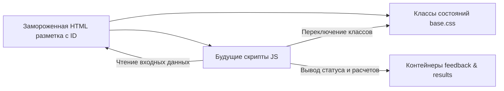

# Requirements

### Обзор и цели
Главная цель на этапе **Midterm Project** — максимизировать практический результат и итоговую оценку за проект путем точного следования регламенту «Заморозки структуры» (Freeze State):
1. **Исключение рукописного JavaScript**: в соответствии с требованиями Midterm, собственный JS-код на данном этапе не добавляется во избежание штрафных баллов за преждевременный функционал.
2. **Полная подготовка разметки и стилей (HTML/CSS Hooks)**: обеспечение максимальной эффективности будущей разработки путем внедрения всех необходимых ID, адаптивных сеток, интерактивных контейнеров и классов состояний уже сейчас.
3. **Целостность и документация**: отражение 3 сквозных пользовательских сценариев (User Journeys) и протокола перекрестной проверки (Quality Pass) в `README.md`.

---

### Объем изменений (Scope)

#### Входит в объем (In Scope):
1. **Подготовка DOM-структуры для фитнес-калькулятора калорий и графика тренировок (`pages/training.html`)**:
   - Разметка адаптивной секции `#fitness-calculator` на Bootstrap 5 сетке с полями ввода параметров (пол, возраст, рост, вес, цель, активность).
   - Создание контейнера результатов `#calculator-results` в исходном скрытом состоянии (`.is-hidden`) с идентификаторами целевых показателей.
2. **Подготовка хуков и контейнеров для интерактивных элементов на всех страницах**:
   - Внедрение контейнеров динамического вывода статусов `#*-form-feedback` во всех формах (`services.html`, `pricing.html`, `training.html`, `contacts.html`).
   - Разметка data-атрибутов (`data-category`, `data-day`) в таблице расписания и кнопок фильтрации.
   - Разметка селекторов тарифов на `pricing.html`.
3. **Декларация классов состояний в `assets/css/base.css`**:
   - Добавление служебных классов `.is-hidden`, `.is-active`, `.is-selected`, `.is-error`, `.is-success`, `.form-feedback-container`.
4. **Документация и соответствие Midterm**:
   - Описание 3 User Journeys и фиксация Quality Pass в `README.md`.

#### Вне объема (Out of Scope):
- Создание и исполнение кастомных `.js` скриптов на этапе Midterm (активен только официальный `bootstrap.bundle.min.js`).

---

### Пользовательские сценарии (User Journeys)
- **Сценарий 1 (Подбор программы и пробная тренировка)**: `index.html` → `pages/services.html` → выбор направления → `pages/contacts.html#contact-form` (подготовлен контейнер подтверждения записи).
- **Сценарий 2 (Расчет абонемента и заказ)**: `index.html` → `pages/pricing.html` → выбор тарифа и срока → `#order-form` (подготовлены хуки пересчета стоимости и вывода подтверждения).
- **Сценарий 3 (Фитнес-диагностика и выбор расписания)**: `index.html` → `pages/training.html` → блок `#fitness-calculator` → просмотр структуры тренировочной недели → `#training-schedule`.

# Technical Design

### Текущее состояние и принципы архитектурной подготовки
- Разметка сайта построена на семантическом HTML5 и Bootstrap 5.3.8 с тёмной темой (`data-bs-theme="dark"`).
- Чтобы в последующих практических работах добавлять логику исключительно через манипуляции с DOM и событиями (Event Listeners), все интерактивные блоки замораживаются в HTML с точными идентификаторами.

---

### Классы состояний в `assets/css/base.css`

```css
/* JavaScript State Classes for future dynamic features */
.is-hidden { display: none !important; }
.is-active { opacity: 1; pointer-events: auto; }
.is-selected { border-color: var(--bs-link-color) !important; box-shadow: 0 0 10px rgba(204, 255, 0, 0.35); }
.is-error { border-color: #dc3545 !important; }
.is-success { border-color: #198754 !important; }
.form-feedback-container { min-height: 1.5rem; transition: all 0.2s ease-in-out; }
```

---

### Спецификация DOM-хуков для калькулятора калорий (`pages/training.html`)

Секция `#fitness-calculator` интегрируется в `pages/training.html`:
- **Поля ввода**:
  - `#calc-gender` (`select`: male / female)
  - `#calc-age` (`input type="number"`: min="14", max="90")
  - `#calc-height` (`input type="number"`: min="120", max="230")
  - `#calc-weight` (`input type="number"`: min="35", max="250")
  - `#calc-activity` (`select`: sedentary, light, moderate, high)
  - `#calc-goal` (`select`: lose, maintain, gain)
  - `#calc-submit-btn` (`button type="button"` или `type="submit"`)
  - `#calc-reset-btn` (`button type="reset"`)
- **Контейнер вывода результатов**:
  - `#calculator-results` (класс `is-hidden bg-body-tertiary border rounded-3 p-4 mt-4`)
  - `#result-bmr` (число базового метаболизма)
  - `#result-tdee` (суточная калорийность с учетом активности)
  - `#result-target-calories` (целевая норма ккал с учетом дефицита/профицита)
  - `#result-workout-freq` (рекомендуемое количество тренировок в неделю)
  - `#result-program-recommendation` (текстовая рекомендация направления: зал, кроссфит, сауна)

---

### Спецификация контейнеров обратной связи для форм

В каждой форме сайта под кнопками действий внедряется стандартизированный контейнер:
- `pages/contacts.html`: `<div id="contact-form-feedback" class="form-feedback-container mt-3" aria-live="polite"></div>`
- `pages/pricing.html`: `<div id="pricing-order-feedback" class="form-feedback-container mt-3" aria-live="polite"></div>`
- `pages/services.html`: `<div id="booking-form-feedback" class="form-feedback-container mt-3" aria-live="polite"></div>`
- `pages/training.html`: `<div id="signup-form-feedback" class="form-feedback-container mt-3" aria-live="polite"></div>`

---

### Архитектурная диаграмма взаимодействия компонентов



# Testing

### Стратегия валидации на этапе Midterm

#### 1. Статическая валидация разметки
- Валидация всех 7 HTML-страниц через W3C Nu HTML Checker: 0 ошибок, 0 предупреждений.
- Проверка уникальности всех `id` на каждой странице (отсутствие дубликатов).
- Проверка семантической вложенности (нет `div` внутри `ul` в обход `li`, корректные `form-label` и `for`).

#### 2. Проверка изоляции от непреднамеренных скриптов
- В консоли браузера отсутствуют ошибки `404` (несуществующие `.js` файлы) и синтаксические предупреждения.
- Единственный подключенный скрипт — официальный `bootstrap.bundle.min.js`.

#### 3. Адаптивность и визуальный контроль
- Проверка страниц на контрольных брейкпоинтах: 375px (смартфон), 768px (планшет), 1440px (десктоп).
- Отсутствие горизонтального скролла страницы при размещении новых заготовок калькулятора и контейнеров.

# Feature Options

### Зарезервированные точки расширения под будущий JavaScript

1. **Модуль калькулятора калорий и графика тренировок (`pages/training.html`)**:
   - Ядро на основе формулы Миффлина — Сан-Жеора.
   - Автоматический расчет БЖУ и рекомендаций тренировочного плана.
2. **Модуль фильтрации расписания (`pages/training.html`)**:
   - Мгновенная сортировка и фильтрация занятий по категориям (Тренажерный зал / Кроссфит / Групповые) через `data-category`.
3. **Модуль клиентской валидации и маски телефона**:
   - Автоформатирование поля `+7 (7XX) XXX-XX-XX` и вывод сообщений в заготовленные контейнеры `#*-form-feedback`.
4. **Кэширование в `localStorage`**:
   - Сохранение введенных параметров калькулятора и выбранного филиала.

# Delivery Steps

### ✓ Step 1: Подготовка CSS-классов состояний в assets/css/base.css
Внедрение деклараций динамических состояний для будущих JS-манипуляций.

- Добавить правила `.is-hidden`, `.is-active`, `.is-selected`, `.is-error`, `.is-success` в `assets/css/base.css`.
- Задать параметры высоты и плавного перехода для `.form-feedback-container`.
- Проверить, что общий объем рукописного CSS остается компактным и не нарушает принципы Assignment 3.

### ✓ Step 2: Разметка DOM-крючков и полей калькулятора в pages/training.html
Создание адаптивного каркаса калькулятора калорий и плана тренировок без использования JS.

- Разместить секцию `#fitness-calculator` с полями ввода (`#calc-gender`, `#calc-age`, `#calc-height`, `#calc-weight`, `#calc-activity`, `#calc-goal`).
- Сформировать разметку блока результатов `#calculator-results` с классом `.is-hidden` и уникальными идентификаторами для вывода калорий и тренировок.
- Разместить data-атрибуты для фильтрации расписания (`data-category`, `data-day`) в таблице тренировок.

### ✓ Step 3: Интеграция контейнеров обратной связи и унификация ID во всех формах
Подготовка форм всех 7 страниц к последующей обработке событий и валидации.

- Внедрить пустые контейнеры `<div id="...-feedback" class="form-feedback-container"></div>` под кнопками отправки на страницах `services.html`, `pricing.html`, `contacts.html` и `training.html`.
- Проверить соответствие всех `id` полей и атрибутов `for` у меток `label` стандарту kebab-case.
- Убедиться в наличии атрибутов доступности (`aria-live="polite"`).

### ✓ Step 4: Актуализация документации в README.md и итоговая валидация
Фиксация готовности к Midterm Freeze и подтверждение соответствия критериям оценки.

- Добавить в `README.md` подробное описание 3 сквозных пользовательских сценариев (User Journeys).
- Оформить протокол перекрестной проверки команды (Quality Pass).
- Провести проверку через валидатор HTML и проверить отсутствие ошибок консоли.